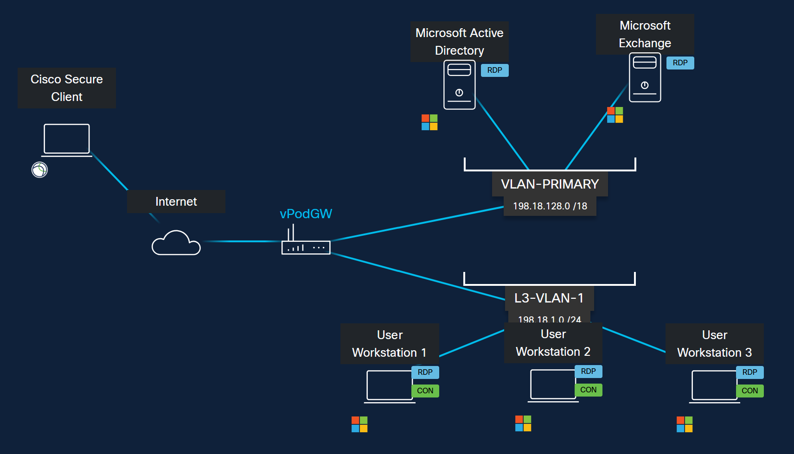

# Lab Introduction

LTRCOL-2651 · AI Receptionist for Webex Calling · Cisco Live Melbourne

**AI Receptionist for Webex Calling**

**LTRCOL-2651**

**Hussain Ali, Technical Marketing Engineer**

November 12, 2026

## Learning Objectives

Upon completion of this lab, you will:

- Have fundamental knowledge of **AI Receptionist for Webex Calling**. Their key capabilities, how to configure them and how they work.

- How to configure an AI Receptionist along with its knowledge base and interact with the AI Receptionist to see the experience

## Scenario

In this lab, you will gain hands-on experience in configuring and testing the **AI Receptionist.** This lab provides step-by-step instructions for setting up an AI Receptionist.

Here are the high-level TASKS to achieve the objectives of this lab:

- TASK 1: Accessing the lab

- TASK 2: Access the Collaboration Control Hub and the Webex App

- TASK 3: Configure an AI Receptionist

- TASK 4: Prepare Webex Calling Customer Assist

- TASK 5: Configure intent-based routing for the AI Receptionist

- TASK 6: Log into the Webex App for all users

- TASK 7: Verify and interact with the AI Receptionist

 

## Lab Topology

In this lab, we have a classroom workstation (physical workstation) and three virtual workstations. You are reading this lab guide from the physical workstation.

{ .lab-screenshot width="1100" loading="lazy" }

You will access the Collaboration Control Hub from workstation 1 (WKST 1 – virtual workstation) to do the lab tasks.

You will need 4 Webex App logins to test calls in this lab:

1. Webex tenant user **Charles Holland** (cholland@&lt;**your pod’s FQDN**&gt;) must be logged into the Webex App from the classroom workstation (physical workstation) or your mobile phone.

2. Webex tenant user **Taylor Bard** (tbard@&lt;**your pod’s FQDN**&gt;) must be logged into the Webex App from workstation 1 (WKST 1 – virtual workstation)

3. Webex tenant user **Anita Perez** (aperez@&lt;**your pod’s FQDN**&gt;) must be logged into the Webex App from workstation 2 (WKST 2 – virtual workstation)

4. Webex tenant user **Kellie Melbie** (kmelby@&lt;**your pod’s FQDN**&gt;) must be logged into the Webex App from workstation 3 (WKST 3 – virtual workstation)

| **User** | **Mail ID** | **Directory Number** | **Webex App Login From** |
| --- | --- | --- | --- |
| Charles Holland | cholland@&lt;**your pod’s FQDN**&gt; | 6018 | Physical Workstation / mobile phone |
| Kellie Melby | kmelby@&lt;**your pod’s FQDN**&gt; | 6050 | Virtual Workstation 3 – WKST 3 |
| Anita Perez | aperez@&lt;**your pod’s FQDN**&gt; | 6017 | Virtual Workstation 2 – WKST 2 |
| Taylor Bard | tbard@&lt;**your pod’s FQDN**&gt; | 6026 | Virtual Workstation 1 – WKST 1 |
