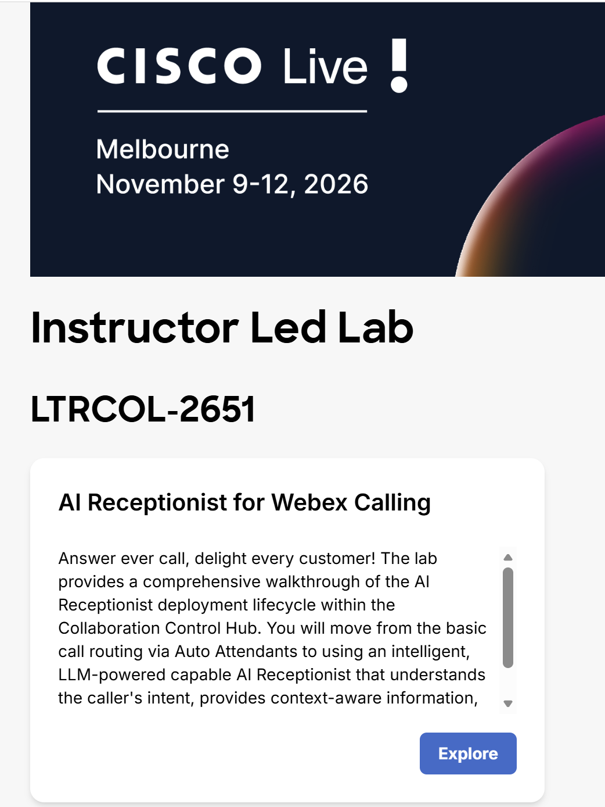
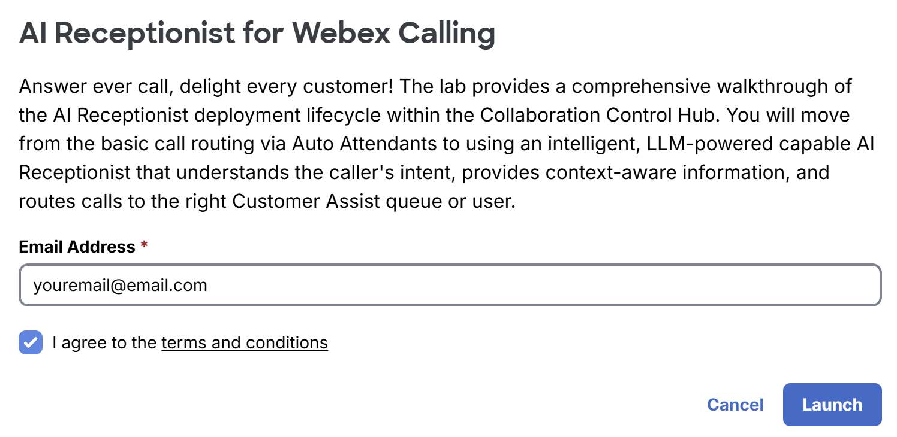
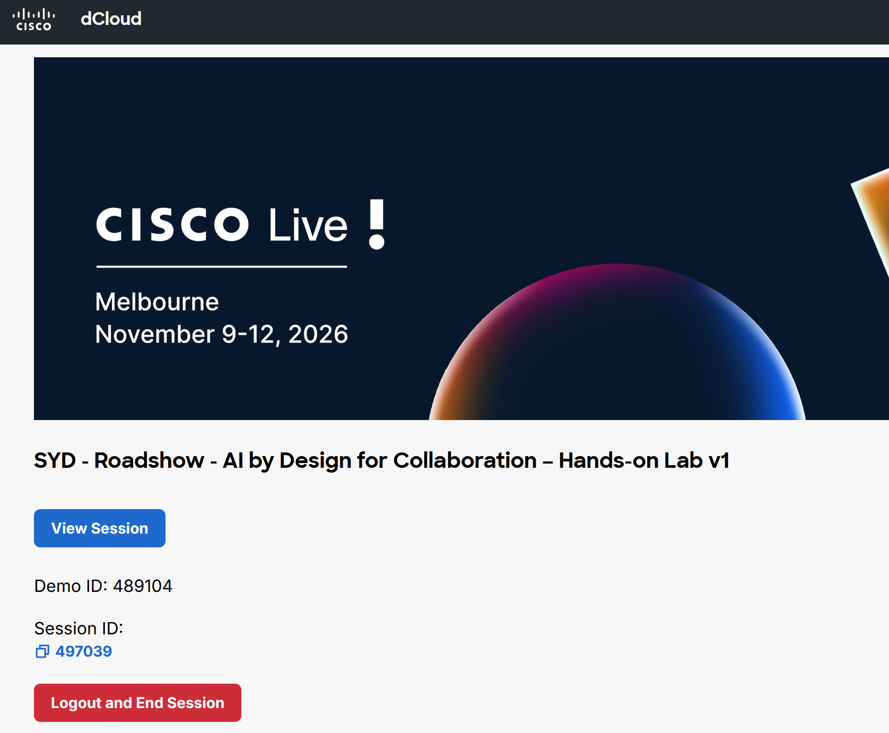
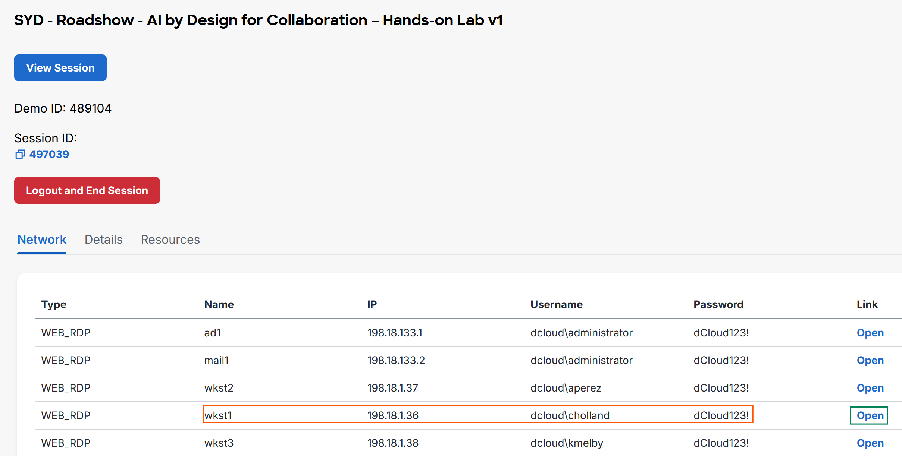
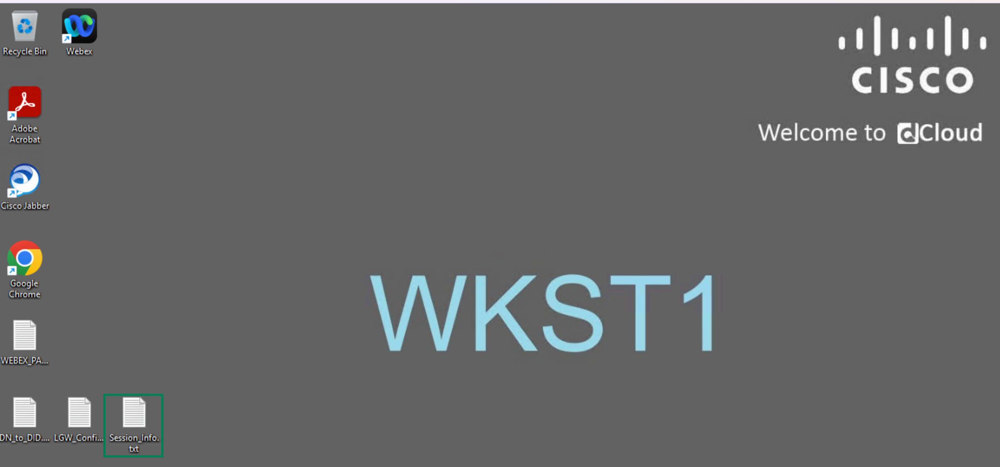
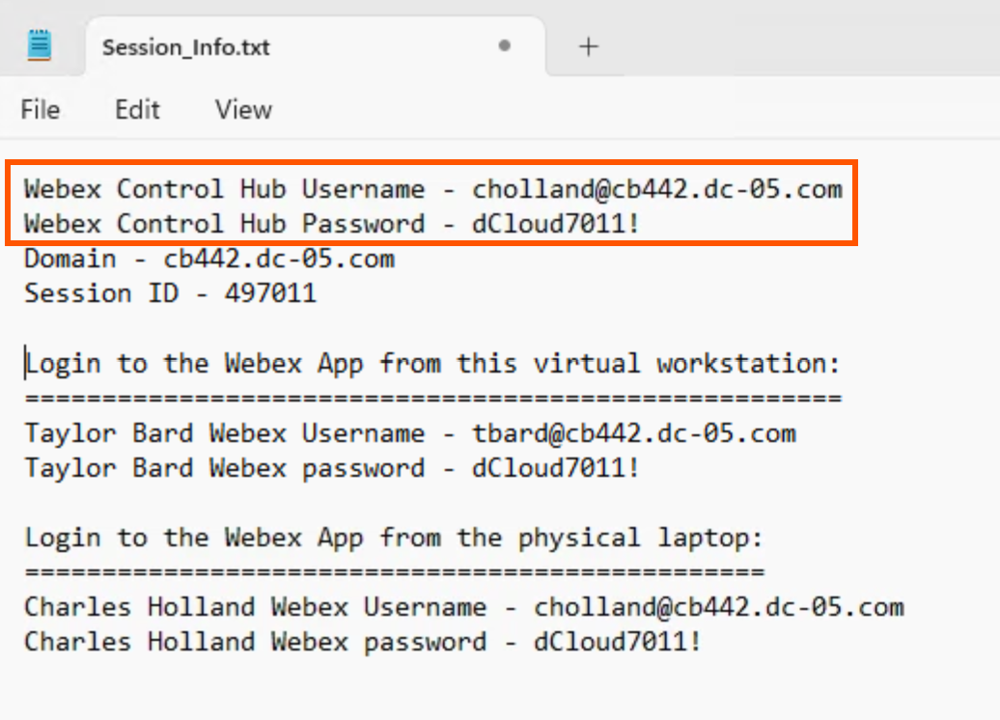
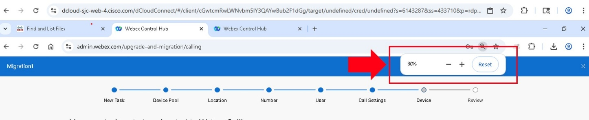

# Task 1: Accessing the Lab

All components for this lab can be accessed through a web browser.

1. Open a browser on your physical workstation and go to [https://www.ciscodcloud.com/apps/expo/7jxnau30vieczrhyqf3e3q371](https://www.ciscodcloud.com/apps/expo/7jxnau30vieczrhyqf3e3q371){ .lab-external-link target="_blank" rel="noopener noreferrer" }

2. Click <strong>Explore</strong> for LTRCOL-2651.  

    { .lab-screenshot width="1042" loading="lazy" }

3. Enter your email and click **Launch.**

{ .lab-screenshot width="1100" loading="lazy" }

4. You will be automatically assigned to a lab pod, and you will be taken to the Lab homepage as shown below.

{ .lab-screenshot width="1100" loading="lazy" }

 

## Step 1: Connect to Workstation 1 via Remote Desktop

Connect to the Remote desktop of Workstation 1. On your session topology page, scroll down. Within the **Network** tab, click **Open** for workstation 1 (wkst 1) under the **Link** column as shown below.

{ .lab-screenshot width="1100" loading="lazy" }

This will launch the workstation 1 using Web Remote Desktop. Within Workstation 1’s Desktop, there will be a file named Session\_info.txt as shown above. Launch the file to get your specific pod’s username and password to be used for the rest of the lab.

{ .lab-screenshot width="1100" loading="lazy" }

**Note: Do not use the usernames and passwords shown in the screenshots in this lab guide. Use the ones presented in your Session\_Info.txt file.**

{ .lab-screenshot width="1036" loading="lazy" }

## Step 2: Display Resolution

If your physical workstation has limited resolution (e.g. 1440x900), you can zoom out to 80% (*Ctrl -*) to have a better view of the screen content for the rest of this lab. Most laptops do not need this.

{ .lab-screenshot width="1100" loading="lazy" }

 
