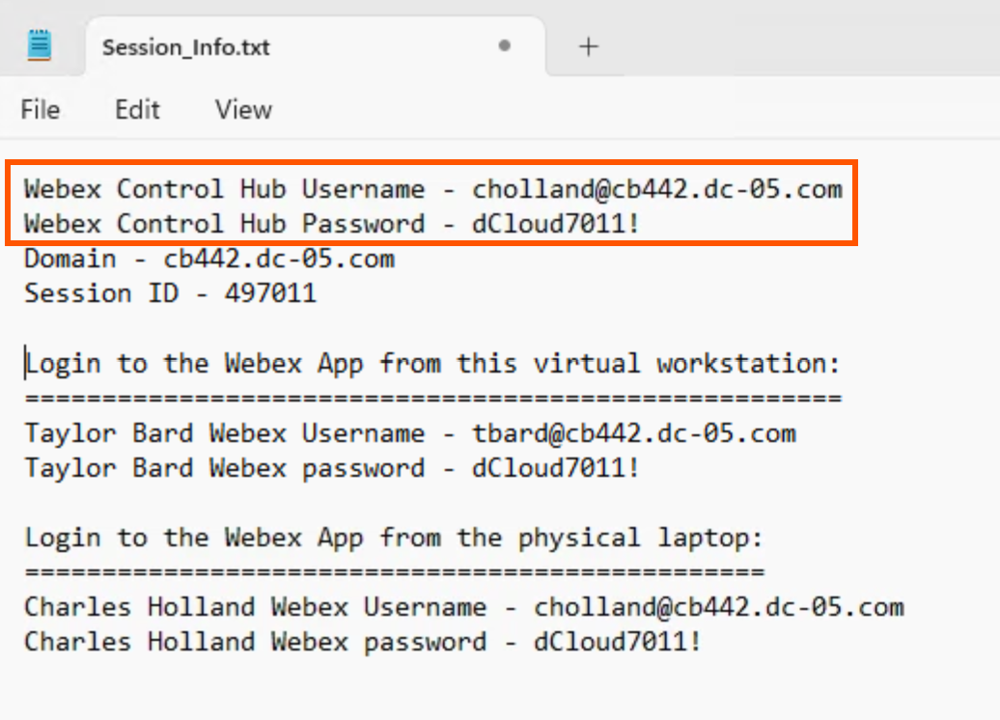
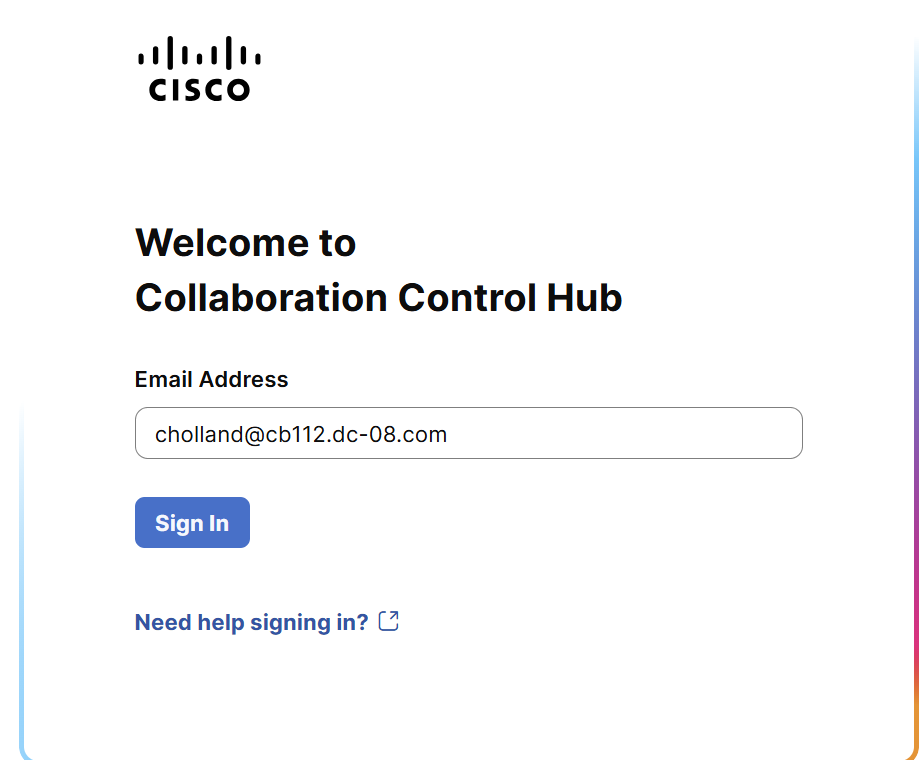
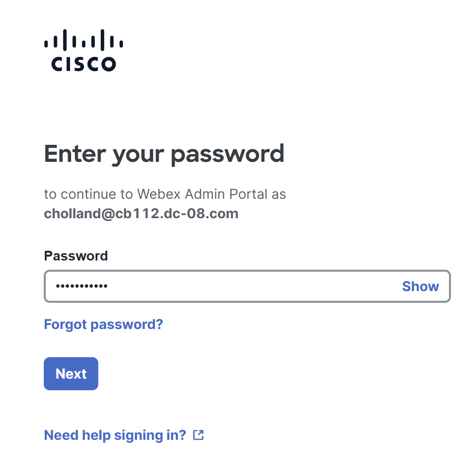
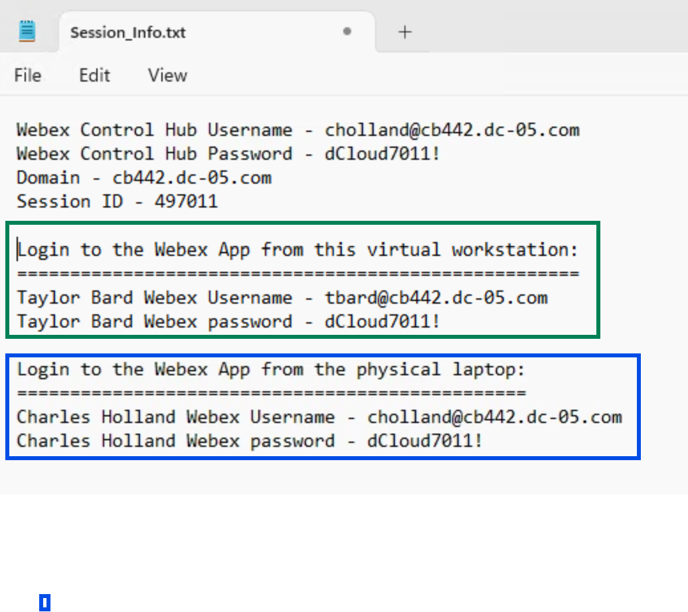

# Task 2: Access Collaboration Control Hub & Webex App

## Step 1: Login to Control Hub

1. Lauch the Chrome browser from within workstation 1 and go to [https://admin.webex.com](https://admin.webex.com/). Login using the credentials from the Session\_info.txt file from the previous section.

**Note: Do not use the username and password shown in the screenshots in this lab guide. Use the one presented in your Session\_Info.txt file. **

{ .lab-screenshot width="1036" loading="lazy" }

1. On the Webex Control Hub login page, login using Charles Holland’s Webex credentials.

{ .lab-screenshot width="920" loading="lazy" }

{ .lab-screenshot width="958" loading="lazy" }

1. Accept any pop-up messages you see when you log-in for the first time.

## Step 2: Login to the Webex App

1. The Webex App should already be logged in from within workstation 1 as **Taylor Bard. **If not, you can login using the credentials from the Session\_Info.txt file as shown below. Additionally, login to the Webex App from the physical workstation or your mobile device as the user Charles Holland.

{ .lab-screenshot width="1036" loading="lazy" }

**This task is now completed. Proceed to the next task. **

 
