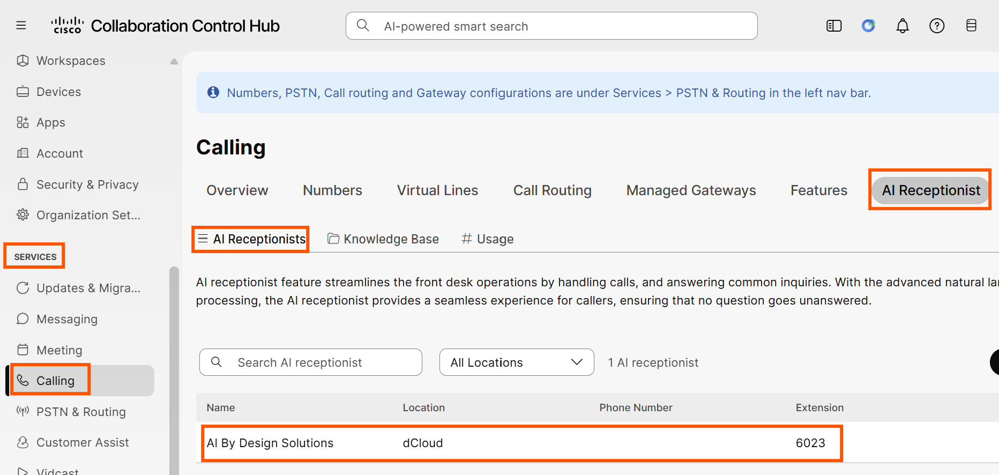
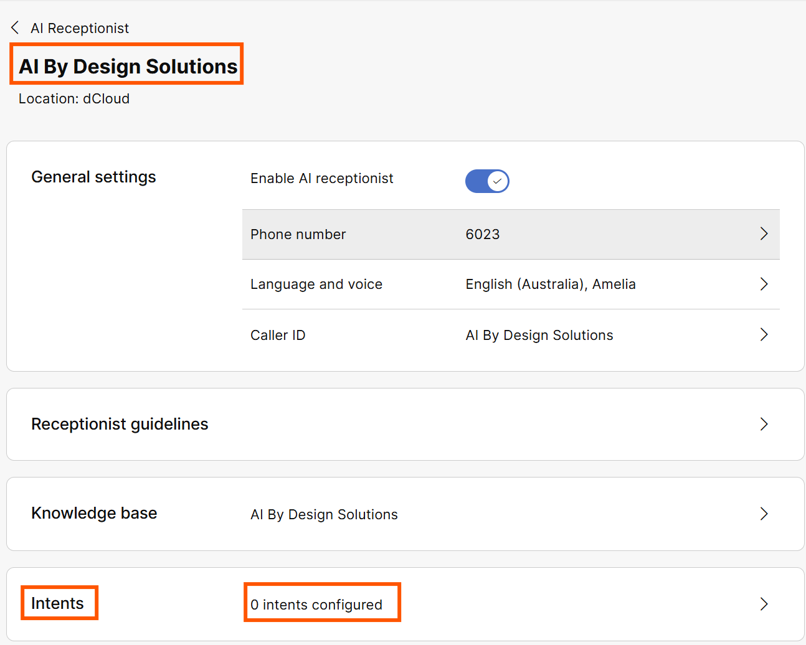
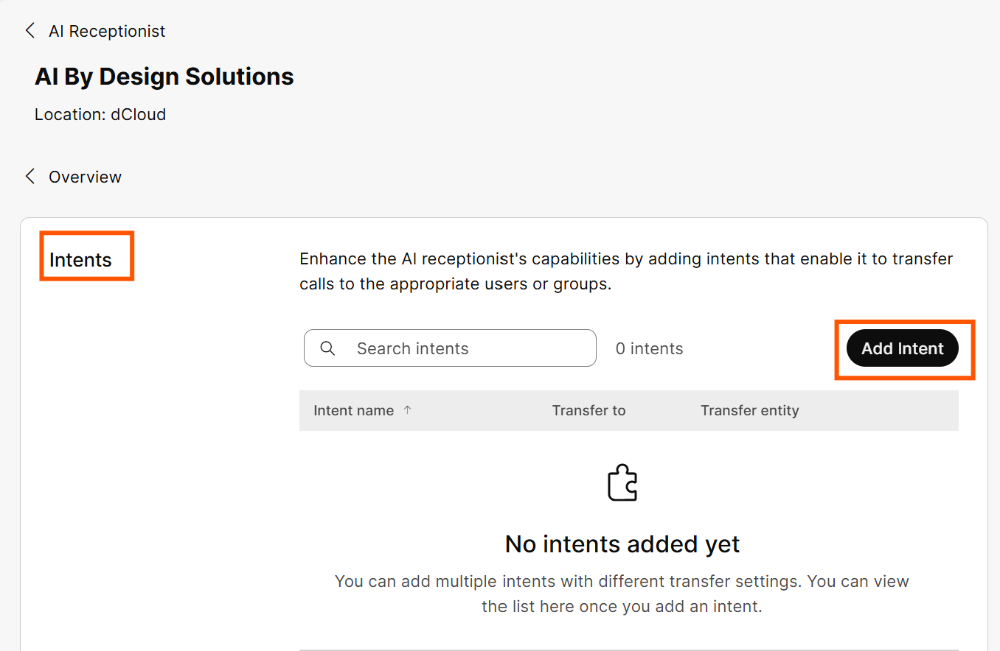
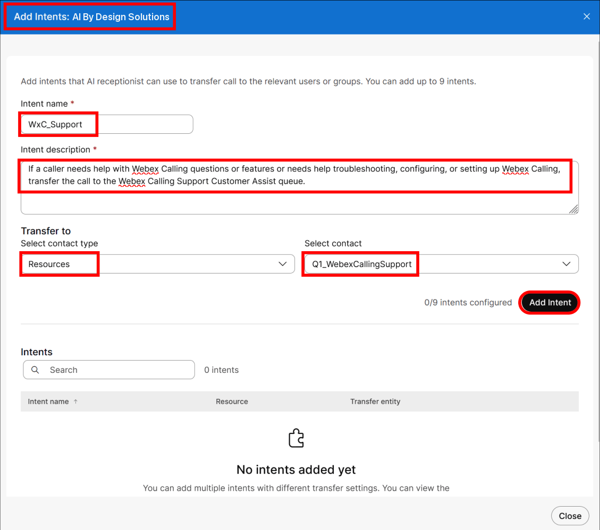
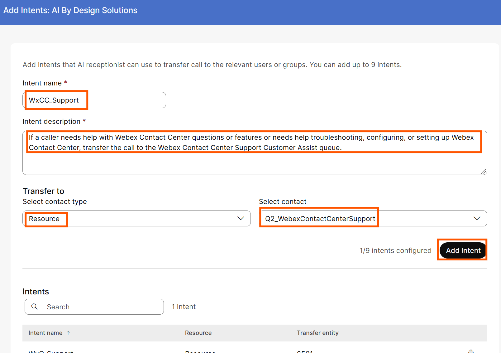
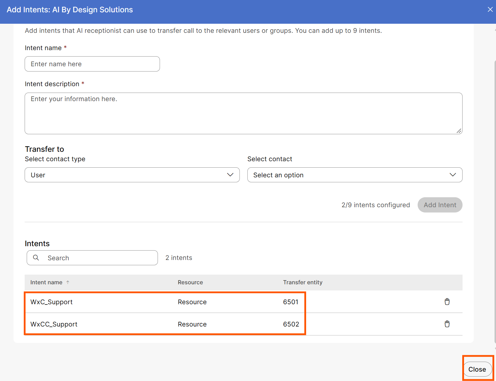
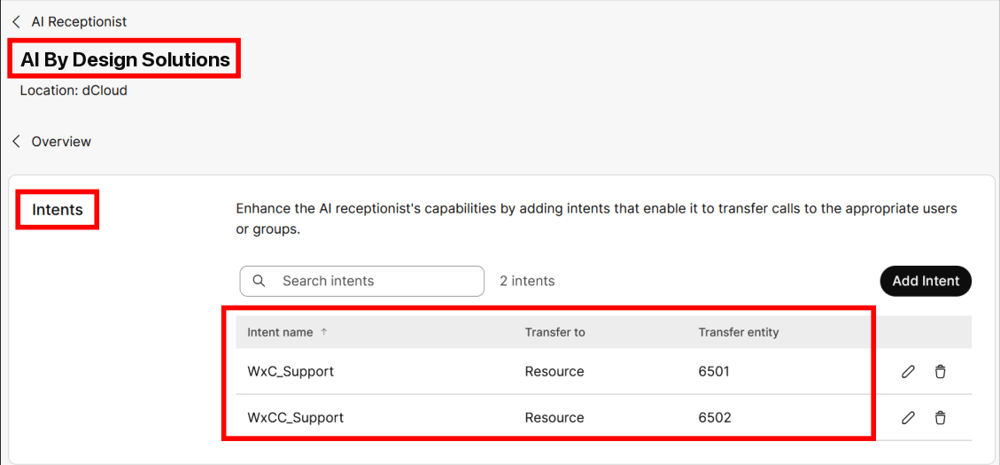
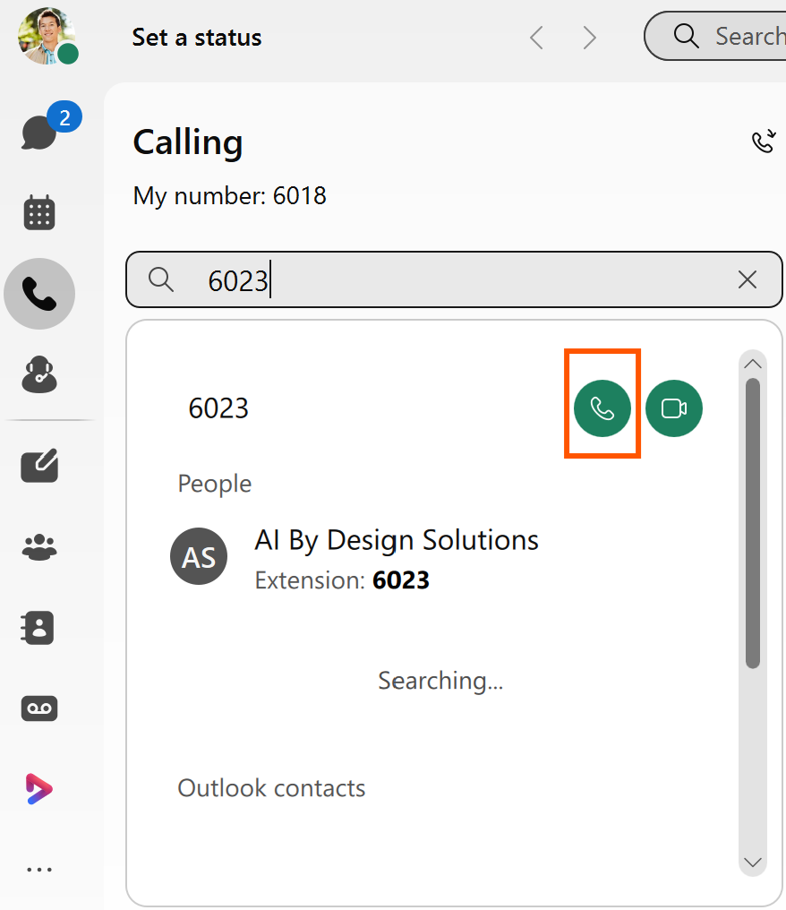

# Task 5: AI Receptionist Intent-Based Routing

You will now configure the AI Receptionist to send calls to the Customer Assist queues. For each queue you will define the criteria that the AI Receptionist will use to determine when to route the call to it.

## Step 1: Add Intentions

**Intents** are used to transfer calls to a defined destination (User, Resource, Organization contact, or Number). In scenarios when a caller is asking for specific information or help that the AI Receptionist cannot handle, you can use intents to send their call to a human, queue/agent or voicemail for additional assistance.

!!! note

    **Note:**
    You can define a maximum of 9 intents.
    There is also the Default Action created for each AI Receptionist, which gives a total of 10 intents for transferring calls from the AI Receptionist to a user, resource (e.g. Customer Assist queue), Org contact or number.

In this lab you will add 2 intents for your **AI By Design Solutions** AI Receptionist:

1) Transfer calls to the **Webex Calling Support Customer Assist queue** when a caller needs help with Webex Calling questions or issues

2) Transfer calls to the **Webex Contact Center Support Customer Assist queue** when a caller needs help with Webex Contact Center questions or issues.

1. Go to **SERVICES &gt; Calling &gt; AI Receptionist**. On the AI Receptionists page, click the **AI By Design Solutions** AI Receptionist.

{ .lab-screenshot width="1100" loading="lazy" }

1. On the AI By Design Solutions page, click **0 intents configured &gt;** in the **Intents** section.

{ .lab-screenshot width="1100" loading="lazy" }

1. On the **Intents** page, click on **Add Intent**.

{ .lab-screenshot width="1100" loading="lazy" }

1. On the **Add Intentions**: **AI By Design Solutions** page, use the following settings to configure the first intent.

These settings are also in the **AI Receptionist Config.txt** file in the **WxC AIR Files** folder **on Workstation 1’s desktop**. You can use this file to copy/paste the information into the configuration.

**Intent name** = WxC\_Support

**Intent Description** = If a caller needs help with Webex Calling questions or features or needs help troubleshooting, configuring, or setting up Webex Calling, transfer the call to the Webex Calling Support Customer Assist queue.

**Transfer to** =

**Contact Type** = Resource

**Contact** = Q1\_WebexCallingSupport

1. Click **Add Intent**

{ .lab-screenshot width="1100" loading="lazy" }

1. You will repeat this process to add a 2nd intent. Use the following settings to configure the second intent.

These settings are also in the **AI Receptionist Config.txt** file in the **WxC AIR Files** folder **on Workstation 1’s desktop**. You can use this file to copy/paste the information into the configuration.

**Intent name** = WxCC\_Support

**Intent Description** = If a caller needs help with Webex Contact Center questions or features or needs help troubleshooting, configuring, or setting up Webex Contact Center, transfer the call to the Webex Contact Center Support Customer Assist queue.

**Transfer to** =

**Contact Type** = Resource

**Contact** = Q2\_WebexContactCenterSupport

1. Click **Add Intent**

{ .lab-screenshot width="1100" loading="lazy" }

1. You should see both intents listed on the **Add Intents: AI By Design Solutions** page. After verifying both intents are listed, click **Close.**

{ .lab-screenshot width="1100" loading="lazy" }

1. On the **Intents** page for the **AI By Design Solutions** AI Receptionist, you will see the 2 newly added intents

 

{ .lab-screenshot width="1100" loading="lazy" }

 

## Call-in Option \[2 minutes\]

!!! note

    **Note:**
    **For the remaining tasks that require calls to test the features, you can test as follows:**
    **From the Webex App on your physical workstation or mobile phone (logged in as Charles Holland) dial the extension you configured for the AI Receptionist (6023)**

### Dial from the Webex App of your physical workstation

1. Log into the Webex App on your physical workstation or mobile phone as **Charles Holland**.

1. Click on the “*Calling*” page in the menu on the left side of the Webex App. You can use the “*Seach or dial*” window or keypad to dial an extension and place the call.

Dial the AI Receptionist (**6023**).

1. Press the “*handset*” icon to initiate the call. Type 6023 in “Search or dial”

{ .lab-screenshot width="878" loading="lazy" }

1. You will hear the AI Receptionist greeting.

**This task is now completed. Proceed to the next task.**

 
