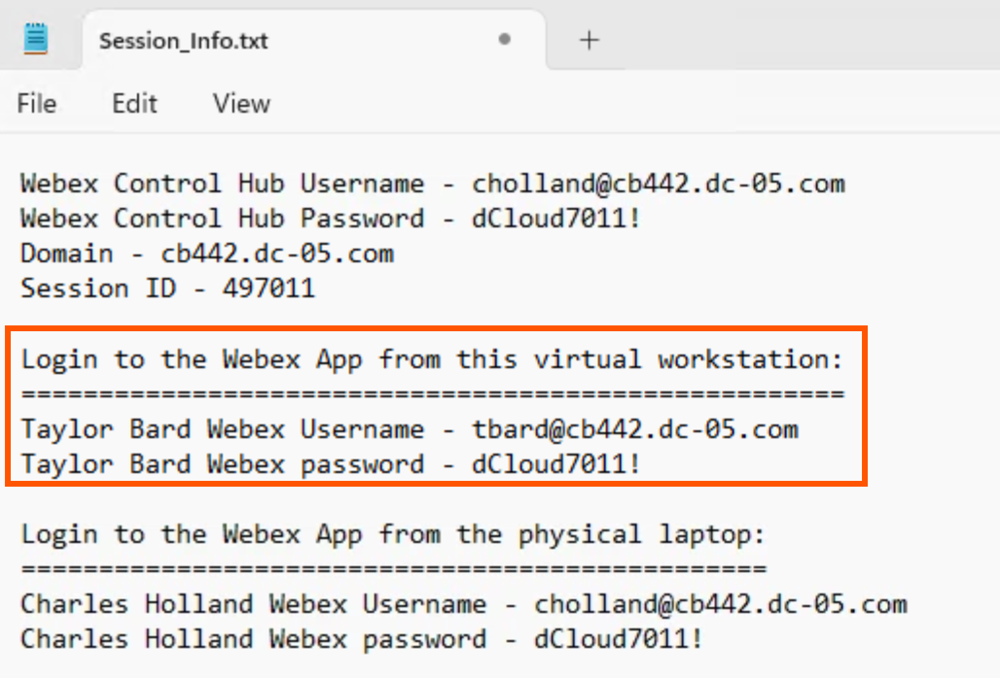
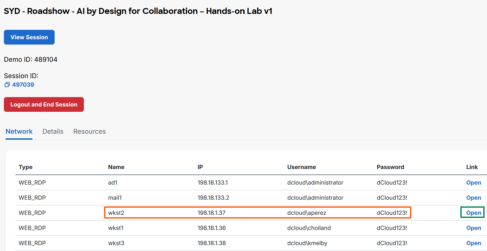
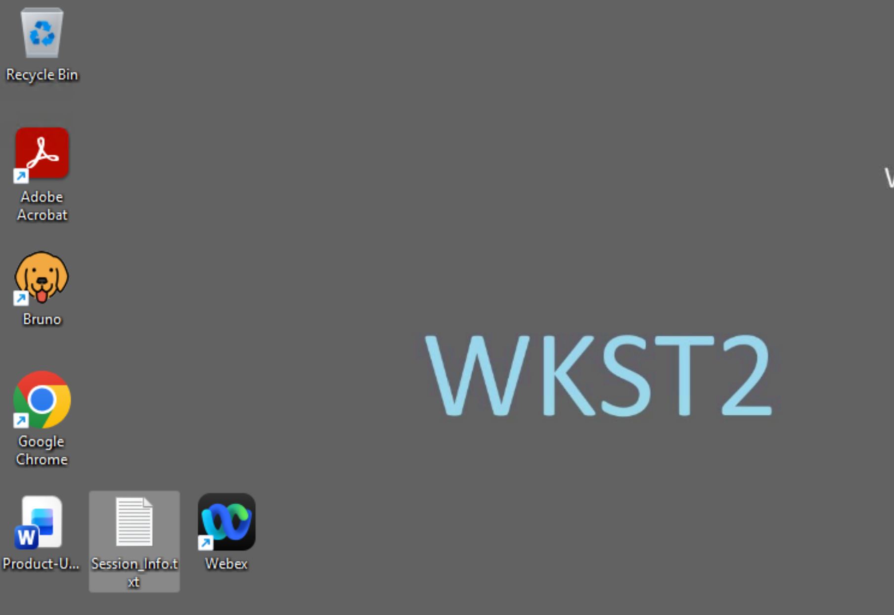
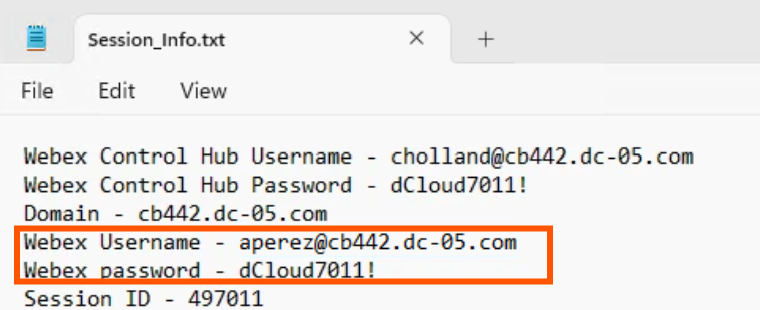
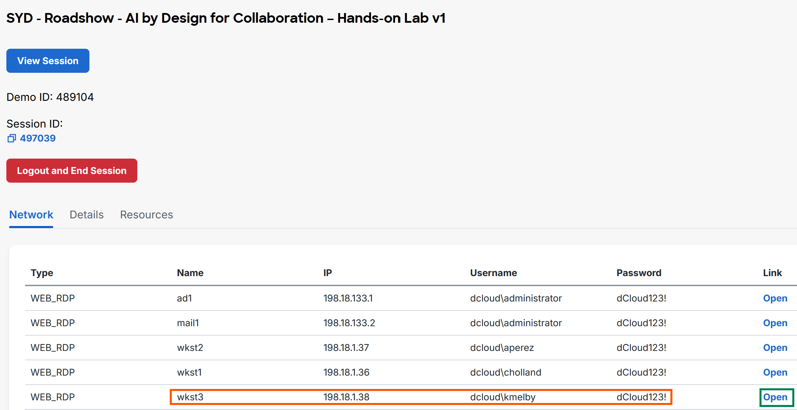
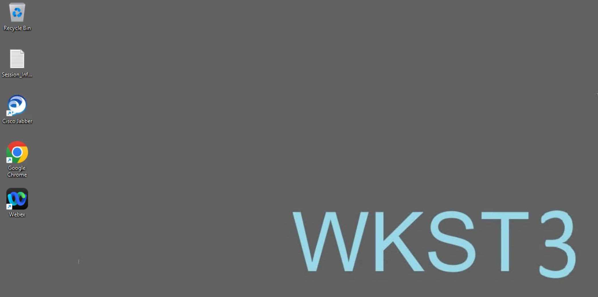
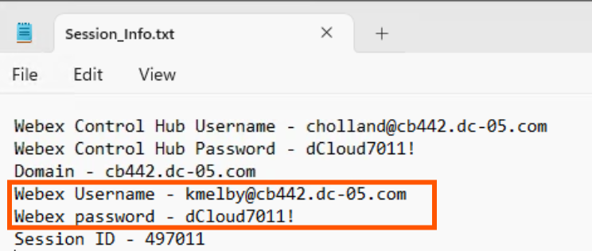

# Task 6: Login Test Users into the Webex App

Let’s ensure you are logged into the Webex App as per the table below.

| **User** | **Mail ID** | **Directory Number** | **Webex App Login From** |
| --- | --- | --- | --- |
| Charles Holland | cholland@&lt;**your pod’s FQDN**&gt; | 6018 | Physical Workstation / mobile phone |
| Kellie Melby | kmelby@&lt;**your pod’s FQDN**&gt; | 6050 | Virtual Workstation 3 – WKST 3 |
| Anita Perez | aperez@&lt;**your pod’s FQDN**&gt; | 6017 | Virtual Workstation 2 – WKST 2 |
| Taylor Bard | tbard@&lt;**your pod’s FQDN**&gt; | 6026 | Virtual Workstation 1 – WKST 1 |

The Customer Assist roles for this lab are as shown below

| User | Queue Name | Role | Workstation to use |
| --- | --- | --- | --- |
| Charles Holland | n/a | Caller / Customer | physical workstation or mobile phone |
| Anita Perez | Q1\_WebexCallingSupport | Agent | Workstation 2 |
| Kellie Melby | Q1\_WebexCallingSupport | Agent | Workstation 3 |
| Taylor Bard | Q2\_WebexContactCenterSupport | Agent | Workstation 1 |

- User IDs and Passwords in the Session\_info.txt of your respective workstations.

## Step 1: Physical Workstation (Charles Holland)

You should already be logged into the Webex App of the classroom workstation (physical workstation) as the user **Charles Holland** to simulate a caller.

**Note:** Do not use the username and password shown in the screenshots in this lab guide. Use the one presented in your Session\_Info.txt file.

 

## Step 2: Workstation 1 – (Taylor Bard logged in to the Webex App)

The Webex App from within workstation 1 (WKST 1) should already be logged in as the user **Taylor Bard, **who is an Agent for Q2. In case you need to login again to the Webex App as Taylor Bard, the credentials can be found in the Session\_Info.txt file placed on the Desktop of WKST 1.

**Note:** Do not use the username and password shown in the screenshots in this lab guide. Use the one presented in your Session\_Info.txt file.

{ .lab-screenshot width="1028" loading="lazy" }

 

## Step 3: Workstation 2 – (Anita Perez logged in to the Webex App)

Connect to the Remote desktop of Workstation 2. On your session topology page, scroll down. Within the **Network** tab, click **Open** for workstation 2 (wkst 2) under the **Link **column as shown below.

{ .lab-screenshot width="1100" loading="lazy" }

This will launch the workstation 2 using Web Remote Desktop. Within Workstation 2’s Desktop, there will be a file named Session\_info.txt as shown below. Launch the file to get your specific pod’s username and password for the user Anita Perez to login to the Webex App.

{ .lab-screenshot width="1100" loading="lazy" }

**Note: Do not use the usernames and passwords shown in the screenshots in this lab guide. Use the ones presented in your Session\_Info.txt file. **

The Webex App from within workstation 2 (WKST 2) should already be logged in as the user **Anita Perez, **who is an Agent for Q1. In case you need to login again to the Webex App as Anita Perez, the credentials can be found in the Session\_Info.txt file placed on the Desktop of WKST 2.

{ .lab-screenshot width="760" loading="lazy" }

 

## Step 4: Workstation 3 – (Kellie Melby logged in to the Webex App)

Connect to the Remote desktop of Workstation 3. On your session topology page, scroll down. Within the **Network** tab, click **Open** for workstation 3 (wkst 3) under the **Link **column as shown below.

{ .lab-screenshot width="1100" loading="lazy" }

This will launch the workstation 3 using Web Remote Desktop. Within Workstation 3’s Desktop, there will be a file named Session\_info.txt as shown below. Launch the file to get your specific pod’s username and password for the user Kellie Melby to login to the Webex App.

{ .lab-screenshot width="1100" loading="lazy" }

**Note: Do not use the usernames and passwords shown in the screenshots in this lab guide. Use the ones presented in your Session\_Info.txt file. **

The Webex App from within workstation 3 (WKST3) should already be logged in as the user **Kellie Melby, **who is an Agent for Q2. In case you need to login again to the Webex App as Kellie Melby, the credentials can be found in the Session\_Info.txt file placed on the Desktop of WKST 3.

{ .lab-screenshot width="744" loading="lazy" }

**This task is now completed. Proceed to the next task. **

 
